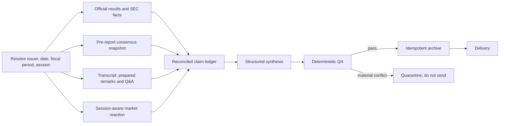

# Earnings research orchestration

## Calendar and delivery safeguards

The Alpha Vantage calendar supplies baseline dates. `core/official_earnings_calendar.py`
refreshes registered issuer announcements (SpaceX and Netflix), follows only issuer-hosted
links, and parses the result-posting sentence instead of the announcement's publication date.
Verified events supersede conflicting estimates within 42 days, including in the Convex
calendar archive. Confirmed events remain available for 60 days for recovery and to prevent
a displaced estimate from reappearing. Register additional issuer news indexes in `ISSUERS`.

Empty post-earnings digests and daily/weekly radars skip email delivery. Radar artifacts
and archive records still record the run and its `no_covered_earnings` delivery reason.
Per-company QA failures remain delivery-blocking; ordinary rounding and historical CapEx
without a claimed guidance change are explicitly accepted by the review instructions.

Previews include calendar EPS consensus as context. Dated, cited consensus revisions can
supersede undated provider values. Historical preview replays skip snapshot writes; snapshots
and reusable artifacts captured after the report date are rejected as pre-report evidence.
Recovery quarantines invalid late consensus without inventing historical capture times.

The deployed research/review model is `gpt-5.4-mini` with low reasoning, a 12,000-token
research output allowance, and a 120-second per-company post-research deadline. The review
distinguishes TTM GAAP margins, quarterly non-GAAP margins, management guidance and consensus.
Valuation proxies are labeled FY consistently in HTML and text. A partial company failure
now fails the job visibly instead of being hidden by another company's successful delivery.

When a pre-earnings narrative fails review, `core/pre_earnings_data_preview.py` can provide a
clearly labeled, deterministic data preview using captured provider estimates and financial
fields. It requires a forward estimate and at least three supported fields, reuses no rejected
prose, invents no fiscal-quarter label, and passes the deterministic pre-delivery checks.

Issuer-verified October 20 SpaceX and Netflix recoveries live in
`cloudflare/verified-post-corrections.json`; recovery can archive them without emailing.

`core/earnings_orchestration.py` is the provider-neutral contract for an earnings run. It answers two separate questions:

1. What evidence must exist before a brief can be trusted?
2. How should a durable runner sequence, retry, degrade, and publish that work?

Generate a concrete plan without making external calls:

```powershell
python pipelines/plan_earnings_research.py `
  --ticker IBM `
  --company "International Business Machines" `
  --report-date 2026-10-21 `
  --report-time AMC `
  --mode post
```

## Provider policy

LLMLayer is always attempted first. Search-result discovery then falls through to Tavily and TinyFish. Full-document and transcript retrieval falls through to TinyFish before Tavily because the important success condition is substantial page text, not another short result snippet. Exa remains an explicit opt-in immediately behind LLMLayer.

A provider failure is an observation, not a workflow failure. Authentication and quota responses such as HTTP 432/433 should open a circuit for that provider for the rest of the run and immediately continue down the waterfall. HTTP 429 and transient network failures may be retried with bounded backoff. The run only fails when a required evidence gate remains unsatisfied after the entire waterfall.

## Evidence flow



Revenue and EPS actuals come from filed or company-issued primary sources. Consensus comes from a timestamped snapshot captured before the report. Transcript text explains why results or guidance changed but does not replace the authoritative financial fact layer. Prepared remarks and analyst Q&A stay separate so management's script and challenged answers can be compared explicitly.

## Cloudflare Workflow mapping

This mapping follows Cloudflare's [Rules of Workflows](https://developers.cloudflare.com/workflows/build/rules-of-workflows/): keep steps granular and idempotent, keep side effects inside steps, and await every step. Large or long-lived source artifacts should be stored externally and represented in Workflow state by a reference.

- The scheduled Worker should only identify eligible events and create Workflow instances. Use a stable composite ID such as `earnings-ibm-2026-10-21-post-v1` so duplicate cron invocations cannot duplicate the run.
- Map each external provider call, archive write, and delivery to its own `step.do()`. A later failure should not repay for earlier successful provider calls.
- Use retryable errors only for transient failures. Treat invalid credentials, quota exhaustion, and failed evidence gates as non-retryable at that provider step; the waterfall decision is a separate deterministic step.
- Store complete releases, decks, and transcripts in durable object storage and return a small content reference plus hash from the step. Keep only focused excerpts and structured facts in Workflow state.
- Archive with the same event/version idempotency key before delivery. Delivery must check the archive and prior delivery state before sending.
- Emit structured stage telemetry: event ID, stage, provider, attempt, latency, result count, degradation reason, evidence-gate result, and final disposition. Never log source text, prompts containing confidential context, or secrets.
- Start in shadow mode. Compare the new claim ledger and final brief with the current Python output before enabling native sends.

The current Python cron jobs can consume the same plan incrementally. The first integration points are the provider ordering in `core/research.py`, transcript caching, and the existing deterministic checks in `core/synthesis.py`.


### Delivery recovery and verification

The previous-business-day preview remains at 5 p.m. Eastern. At 9 a.m., a same-day catchup checks confirmed after-close reporters and sends only missing previews; it closes at 4 p.m. Post-close analysis runs at 6 p.m., with a recovery pass at 8 p.m. Both passes verify AgentMail sent messages for the exact ticker, report date, mode and recipient before generating another report. Archive entries and local drafts do not count as delivery. Receipt lookup failures stop that reporter rather than risk duplicate sends.

Failed coverage runs send an actionable alert identifying failed tickers. Empty calendars and successful runs remain quiet. The existing empty daily, weekly and digest suppression remains enabled. Issuer-confirmed dates replace conflicting provider estimates, including META's October 21, 2026 after-close event.

Post-earnings email analysis preserves the synthesis output’s sourced analyst Q&A as an explicit Earnings call Q&A section in both HTML and Markdown. Empty or incomplete Q&A entries are omitted. For the October 21 META delivery, the temporary verifier requires current-quarter management commentary and analyst Q&A; a release-only email requires a separate transcript follow-up before completion.

Transcript discovery and cache reads require a call/transcript identity, participant or Q&A structure, and the report date near the document header. Previews, generic company pages and wrong-period calls are excluded before synthesis. Workflow failure-alert steps specify a complete retry configuration, including a delay even when retry limit is zero.


Spotify is part of the tracked and dedicated-email universes. Its issuer-confirmed October 22, 2026 before-open report is retained for recovery. Spotify financial results and guidance are EUR; its listed share quote is USD. Native-currency data must not enter USD archive columns without conversion. Previews carry issuer currency, preserve USD stock quotes separately, and omit incompatible structured USD fields.

The container records dashboard-only research failures as `dashboardWarning` while maintaining the separate email-stage result. These failures do not claim a dedicated email was missed. Successful production dashboard post reports archive without sending; true drafts do neither. Plain-text digests include financial bullets even when no price reaction is available.
